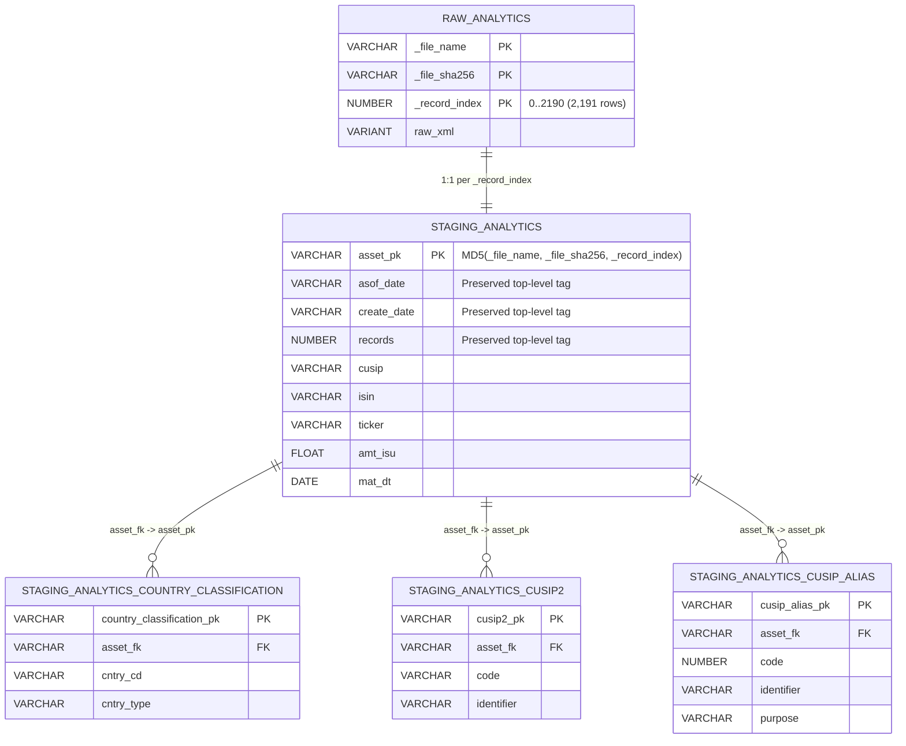
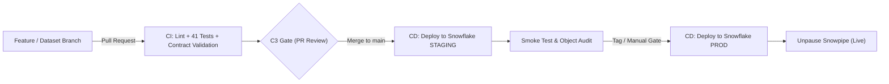

# XML to Snowflake Agent-Assisted Pipeline

An automated, agent-driven data engineering platform that onboards complex, hierarchical raw XML datasets into a Snowflake Medallion Lakehouse architecture without requiring pre-existing XSD schemas or external transformation frameworks (like dbt).

🔗 **Architecture Board:** [Miro — XML to Snowflake Pipeline Architecture](https://miro.com/app/board/uXjVETJagXI=/)

---

## 🌟 Key Features

1. **Intelligent Record-by-Record XML Detection & Ingestion (No 16 MB Single-VARIANT Bottleneck)**:
   - Rather than loading an entire multi-record XML batch file into a single `VARIANT` row, the ingestion engine (`detect_record_xpath` & `extract_xml_records` in [`src/xml_infer.py`](./src/xml_infer.py)) automatically traverses XML batch envelopes (such as `<ASSETS>` &rarr; `<ASSET>`) to identify the true business record unit (e.g. `/ASSETS/ASSET/BND_CORP` in `analytics.xml`).
   - Each record is extracted and loaded into its own separate `VARIANT` row in `RAW.raw_<dataset>` keyed by `(_file_name, _file_sha256, _record_index)` (e.g. **2,191 individual record rows** for `analytics.xml`), while automatically preserving top-level batch attributes (`ASOF_DATE`, `CREATE_DATE`, `RECORDS`) on every record's `raw_xml` payload.

2. **Deterministic Hierarchical Decomposition (No "One Big Flat Table")**:
   - Rather than forcing nested XML collections into a single wide flat table, the engine deterministically identifies repeating child XML collections within each record (e.g. `<COUNTRY_CLASSIFICATION_record>`, `<CUSIP2_record>`, `<CUSIP_ALIAS_record>`, `<LineItem>`) and explodes each child hierarchy into its own relational table across **STAGING** and **CURATED** layers.
   - Automatically generates deterministic MD5 surrogate primary keys (`<entity>_pk`) incorporating `_record_index` and links child tables to their parent record via explicit foreign keys (`<parent>_fk` &rarr; `<parent>_pk`).

3. **Pure 3-Layer Snowflake Medallion Architecture (No dbt Required)**:
   - **Layer 1 (`RAW` schema)**: Normal table (`RAW.raw_<dataset>`) loaded via Snowpipe (`RAW.pipe_<dataset>`) from ADLS (`@RAW.ADLS_XML_STAGE/<dataset>/` with `STRIP_OUTER_ELEMENT = TRUE`), storing one immutable XML record per row (`_record_index`, `raw_xml VARIANT`) alongside preserved batch-level metadata and an **ingestion timestamp** (`_ingestion_ts`, `DEFAULT CURRENT_TIMESTAMP()`) that acts as the incremental watermark for every downstream Dynamic Table.
   - **Layer 2 (`STAGING` schema)**: **Incremental** Declarative Snowflake Dynamic Tables (`TARGET_LAG = '5 minutes'`, `REFRESH_MODE = INCREMENTAL`; only rows with new `_ingestion_ts` are processed, and `_ingestion_ts` is carried on every staging row) executing direct typed `XMLGET` extraction for the primary record table (`STAGING.staging_<dataset>`, 1:1 with `RAW`) and `LATERAL FLATTEN` extraction for every nested child collection (`STAGING.staging_<dataset>_<child>`).
   - **Layer 3 (`CURATED` schema)**: Declarative Snowflake Dynamic Tables (`TARGET_LAG = '15 minutes'`) with automated SCD Type 2 version history on the root record entity: `valid_start_time` = `_ingestion_ts` of the version, `valid_end_time` = ingestion time of the next version (`NULL` while current), and `is_current` = `TRUE` for the live version / `FALSE` for history. A new version is created only when `_row_hash` changes; `_row_hash` is computed from non-key business attributes and **excludes timestamp columns, batch-envelope tags (`ASOF_DATE`, `CREATE_DATE`, `RECORDS`) and load metadata** and foreign-keyed child Dynamic Tables (`CURATED.curated_<dataset>_<child>`).
   - **Operations (`OPS` schema)**: Houses `OPS.quarantine_<dataset>`, `OPS.dq_results_<dataset>`, and the `OPS.v_sla_dashboard_<dataset>` monitoring view.

4. **Mandatory C3 Human Approval Gates & Visual ER Diagram**:
   - **Gate 1 (Schema & Model Approval)**: Mandatory review step before any SQL DDL is generated. Data Stewards inspect the 3-layer YAML specifications (`raw_schema.yaml`, `staging_schema.yaml`, `gold_schema.yaml`, `data_model.yaml`) alongside an interactive **Mermaid ER Diagram** showing all parent-child tables and `1:N` foreign key relationships.
   - **Gate 2 (Go-Live Sign-Off)**: Mandatory sign-off after passing A5 Smoke Testing (`quarantine_open_rows == 0`) before deploying live to Snowflake via External Browser SSO.

5. **In-Stream Quality Gates (A3) & Self-Healing Schema Drift (C1/C2)**:
   - **G1 Files Gate (ADLS &rarr; RAW)**: File non-empty check, SHA-256 idempotency deduplication, and XML well-formedness.
   - **G2 Contract Gate (RAW &rarr; STAGING)**: Required XPaths, Snowflake type cast compatibility, row count bounds, and unknown element detection.
   - **G3 Business Gate (STAGING &rarr; CURATED)**: Primary key uniqueness, non-null assertions, accepted value domains, and numeric range checks.
   - **C1 Drift & C2 Proposal Agents**: Non-breaking additive elements auto-apply to their enclosing record/child entity; breaking changes route to `OPS.quarantine_<dataset>` and generate C2 mitigation proposals for C3 human review.

6. **Antigravity Custom Workspace Skill (`/dataset-onboarding`)**:
   - Project-scoped skill at [`.agents/skills/dataset-onboarding/SKILL.md`](./.agents/skills/dataset-onboarding/SKILL.md) that guides you interactively through onboarding any new XML dataset with built-in C3 human approval gates.

---

## 🕰️ How SCD Type 2 Works (CURATED Layer)

**Pipeline of timestamps**: Snowpipe sets `RAW._ingestion_ts` when a record lands &rarr; STAGING (incremental Dynamic Table) carries it unchanged &rarr; CURATED turns it into `valid_start_time`.

**Algorithm** (root entity, e.g. `CURATED.curated_analytics`), per business key (e.g. `cusip`):
1. **Hash**: `_row_hash = SHA2(CONCAT_WS('|', non-key business attributes))`. Excluded: business keys, timestamp columns, batch-envelope tags (`ASOF_DATE`, `CREATE_DATE`, `RECORDS`) and load metadata, so a reload of identical data never creates a new version.
2. **Detect changes**: order rows by `_ingestion_ts, _file_name`; keep a row only if its `_row_hash` differs from the previous row's (`LAG`). Unchanged re-deliveries are dropped.
3. **Build validity window** with `LEAD`:
   - `valid_start_time` = the version's `_ingestion_ts`
   - `valid_end_time` = next version's `_ingestion_ts` (`NULL` if none)
   - `is_current` = `TRUE` when there is no next version, else `FALSE` (history)

**Example** (`cusip = 123`, `amt_isu` changes in file 2; file 3 is identical to file 2):

| _ingestion_ts | amt_isu | _row_hash | kept? | valid_start_time | valid_end_time | is_current |
| :--- | :--- | :--- | :--- | :--- | :--- | :--- |
| 2026-11-01 | 100 | `a1…` | yes | 2026-11-01 | 2026-11-05 | FALSE |
| 2026-11-05 | 150 | `b2…` | yes | 2026-11-05 | `NULL` | TRUE |
| 2026-11-09 | 150 | `b2…` | no (same hash) | – | – | – |

**Query patterns**
```sql
SELECT * FROM CURATED.curated_analytics WHERE is_current;                       -- latest state
SELECT * FROM CURATED.curated_analytics
WHERE cusip = '123' AND '2026-11-03' >= valid_start_time
  AND ('2026-11-03' < valid_end_time OR valid_end_time IS NULL);                -- point-in-time (as-of)
```

**Notes**
- It is fully declarative: a Dynamic Table recomputes versions, so no MERGE/UPDATE logic is needed, and late-arriving files re-sequence correctly by `_ingestion_ts`.
- History is based on *ingestion* time, not business effective date.
- Child tables are not versioned; they carry `_row_hash`, `_ingestion_ts` and an `<parent>_fk` to the parent record.
- Window functions over full history may force full refreshes, so curated uses `REFRESH_MODE = AUTO`.

---

## 🧩 Intelligent Record-by-Record Ingestion & Entity Decomposition (`analytics.xml` Example)

For batch XML feeds like [`datasets/analytics/samples/analytics.xml`](./datasets/analytics/samples/analytics.xml):
- **Batch Envelope**: `<ASSETS ASOF_DATE="5/11/2026" CREATE_DATE="5/11/2026" RECORDS="002191">` wraps 2,191 `<ASSET><BND_CORP>...</BND_CORP></ASSET>` corporate bond records.
- **Record Identification**: The agent identifies `/ASSETS/ASSET/BND_CORP` as the repeating business record (`record_element`), stamps the top-level attributes (`ASOF_DATE`, `CREATE_DATE`, `RECORDS`) onto each `<BND_CORP>` element, and loads **2,191 rows** into `RAW.raw_analytics` (`_record_index` `0..2190`).
- **4-Table Relational Hierarchy in `STAGING` & `CURATED`**:



---

## 📁 Repository Structure

```text
xml_to_snowflake/
├── .agents/                         # Antigravity workspace customizations
│   ├── skills/
│   │   └── dataset-onboarding/      # Guided interactive XML dataset onboarding skill
│   │       └── SKILL.md
│   ├── rules/                       # Project rules (graphify knowledge graph sync)
│   └── workflows/                   # Standard operational workflows
├── config/                          # Global pipeline, LLM, DataHub & Snowflake settings
│   └── settings.yaml
├── datasets/                        # Dataset packages (samples, schemas, SQL)
│   ├── analytics/                   # Corporate bond (<ASSET>/<BND_CORP>) hierarchical dataset
│   ├── enterprise_orders/           # Enterprise purchase orders
│   └── orders/                      # Core orders dataset package
├── registry/                        # C4 Git-versioned Schema Registry per dataset
│   └── <dataset>/
│       ├── raw_schema.yaml          # Layer 1 Normal Table specification (RAW schema)
│       ├── staging_schema.yaml      # Layer 2 Dynamic Table specs (parent + child entities)
│       ├── gold_schema.yaml         # Layer 3 Curated Dynamic Table specs (SCD2 + FKs)
│       ├── data_model.yaml          # Medallion data model, FK relationships & Mermaid ER diagrams
│       ├── mapping.yaml             # Canonical field inventory & XPath expressions
│       ├── contract.yaml            # G2 Contract specification
│       ├── quality_rules.yaml       # G3 Business quality rules
│       ├── sql/                     # Step 2 generated SQL scripts per layer
│       │   ├── 01_raw_snowpipe.sql
│       │   ├── 02_staging_dynamic_table.sql
│       │   ├── 03_gold_dynamic_table.sql
│       │   └── 04_ops_quarantine_dq.sql
│       └── ddl.sql                  # Consolidated master Snowflake DDL
├── samples/                         # Raw sample & drift XML files
├── snowflake_bootstrap/             # One-time Account-level Snowflake setup
│   ├── account_bootstrap.sql        # RBAC roles, Warehouse, Database & 4 Schemas (RAW, STAGING, CURATED, OPS)
│   └── README.md
├── src/                             # Core Agent implementations and Control Plane Web UI
│   ├── agents/                      # Multi-agent pipeline (A0–A5, C0–C2, Step 2 DDL Generator)
│   │   ├── a0_intake.py             # XML discovery & sample validation
│   │   ├── c0_bootstrap.py          # Step 1: Data Steward & 3-layer hierarchical modeling agent
│   │   ├── ddl_generator_agent.py   # Step 2: Snowflake DDL compilation agent
│   │   ├── a1_provision.py          # Step 3: Deployment & local warehouse simulator
│   │   ├── a2_catalog.py            # DataHub metadata & lineage emitter
│   │   ├── a3_quality_gates.py      # G1, G2, G3 runtime quality gate evaluator
│   │   ├── a4_monitoring.py         # O2/O5 SLA views & operational monitoring
│   │   ├── a5_smoke_test.py         # End-to-end smoke test runner
│   │   ├── c1_drift_agent.py        # Schema drift detector
│   │   └── c2_proposal_agent.py     # Drift mitigation proposer
│   ├── entity_model.py              # Parent/child XML entity decomposition & Mermaid ER generator
│   ├── ddl_compiler.py              # Snowflake Snowpipe & multi-entity Dynamic Table DDL compiler
│   ├── xml_infer.py                 # XML XPath discovery & narrowest Snowflake type ladder
│   ├── snowflake_client.py          # Snowflake connector (External Browser SSO & live deployment)
│   ├── web_app.py                   # Starlette/Uvicorn Control Plane UI backend
│   └── ui/                          # Web UI dashboard with interactive Mermaid ER viewer
├── tests/                           # End-to-end automated unit & regression test suite
├── requirements.txt                 # Python dependencies
└── README.md
```

---

## 🚀 Quickstart

### 1. Prerequisites
Install required Python packages:
```bash
pip install -r requirements.txt
```

### 2. Bootstrap Snowflake (One-Time)
Run [`snowflake_bootstrap/account_bootstrap.sql`](./snowflake_bootstrap/account_bootstrap.sql) in Snowflake as `ACCOUNTADMIN` to provision:
- Warehouse: `COMPUTE_WH` (5-minute auto-suspend)
- Roles: `DATA_ENGINEER_ROLE`, `DATA_STEWARD_ROLE`, `DATA_ANALYST_ROLE`, `DATAHUB_READER_ROLE`
- Database: `ENTERPRISE_DW`
- Schemas: `RAW`, `STAGING`, `CURATED`, and `OPS`

### 3. Option A — Onboard via the Control Plane Web UI
Start the web dashboard:
```bash
python -m src.web_app
```
Open **[http://127.0.0.1:8765](http://127.0.0.1:8765)** to:
1. Run **Step 1 (Data Steward Agent)** on sample XML files to generate 3-layer YAML schemas (no DDL yet).
2. Inspect the **Proposed Data Model Diagram (Mermaid ER)** in **Tab ②** showing parent and child tables (`staging_<ds>` and `staging_<ds>_<child>`) linked via `<parent>_fk` &rarr; `<parent>_pk`.
3. Approve the YAMLs at **C3 Gate 1** to trigger **Step 2 (DDL Generator Agent)** and **Step 3 (Pipeline Deployment + A2–A5 Smoke Test)**.
4. Review the A5 Smoke Test report in **Tab ⑤** (**C3 Gate 2**) and deploy live to Snowflake via External Browser SSO.

### 4. Option B — Onboard via the `/dataset-onboarding` AI Skill
In the chat interface, invoke:
```text
/dataset-onboarding
```
The agent will execute the same gated workflow interactively in chat — presenting the parent/child table breakdown and Mermaid ER diagram at **Gate 1** before compiling SQLs, running the A5 smoke test, and pausing at **Gate 2** before live Snowflake deployment.

---

## 🔄 CI/CD & GitOps Integration

This repository includes automated CI/CD pipelines configured via **GitHub Actions**:



### 1. Workflows
- **Continuous Integration (`.github/workflows/ci.yml`)**:
  - Matrix testing across Python `3.10`, `3.11`, and `3.12`.
  - Static code analysis and linting (`ruff`).
  - Strict Pydantic contract validation of `registry/<dataset>/mapping.yaml` and `entity_model.yaml`.
  - Comprehensive execution of all 41 unit and integration tests.
- **Continuous Delivery (`.github/workflows/cd.yml`)**:
  - Automated deployment of compiled DDLs, Snowpipes, and Dynamic Tables to Snowflake using [`scripts/deploy_snowflake_cicd.py`](./scripts/deploy_snowflake_cicd.py).
  - Target environments: `STAGING` on merge to `main`, and `PROD` on manual GitHub environment release.
  - Automated post-deployment object verification using [`scripts/audit_snowflake_objects.py`](./scripts/audit_snowflake_objects.py).

### 2. GitHub Secrets Setup
To enable headless deployment from GitHub Actions, configure the following repository secrets:
| Secret Name | Description |
| :--- | :--- |
| `SF_ACCOUNT` | Snowflake Account Identifier (e.g., `yldulxm-dc69211`) |
| `SF_CI_USER` | CI/CD Service Account User (e.g., `SVC_GITHUB_ACTIONS`) |
| `SF_CI_PASSWORD` | Service Account Password or PAT (or RSA Private Key) |
| `SF_ROLE` | Snowflake Role (defaults to `DATA_ENGINEER_ROLE`) |
| `SF_WAREHOUSE` | Snowflake Warehouse (defaults to `COMPUTE_WH`) |
| `SF_DATABASE_STAGING` | Staging database (defaults to `STAGING_DW`) |
| `SF_DATABASE_PROD` | Production database (defaults to `ENTERPRISE_DW`) |

---

## 🔮 Pending Integrations & Architecture Roadmap

### 1. Snowflake Native Git Integration
Snowflake supports direct integration with Git repositories using API integrations:
```sql
-- Create API Integration for GitHub access
CREATE OR REPLACE API INTEGRATION github_api_integration
  API_PROVIDER = git_https_api
  API_ALLOWED_PREFIXES = ('https://github.com/piyush271986/')
  ENABLED = TRUE;

-- Create Git Repository Stage in Snowflake
CREATE OR REPLACE GIT REPOSITORY ENTERPRISE_DW.OPS.xml_to_snowflake_repo
  API_INTEGRATION = github_api_integration
  ORIGIN = 'https://github.com/piyush271986/xml_to_snowflake.git';

-- Execute version-controlled Dynamic Table DDL directly from the Git stage
EXECUTE IMMEDIATE FROM @ENTERPRISE_DW.OPS.xml_to_snowflake_repo/branches/main/registry/analytics/sql/02_staging_dynamic_table.sql;
```

### 2. Azure Data Lake Storage (ADLS Gen2) Event-Driven Ingestion
Automate XML ingestion directly as files land in ADLS Gen2 using Azure Event Grid and Snowflake Snowpipe:
```sql
-- Storage Integration for Azure Blob / Data Lake Gen2
CREATE OR REPLACE STORAGE INTEGRATION adls_xml_storage_int
  TYPE = EXTERNAL_STAGE
  STORAGE_PROVIDER = 'AZURE'
  ENABLED = TRUE
  AZURE_TENANT_ID = '<tenant-id>'
  STORAGE_ALLOWED_LOCATIONS = ('azure://<storage-account>.blob.core.windows.net/<container>/xml_inbound/');

-- Auto-Ingest Snowpipe subscribed to Azure Event Grid (STRIP_OUTER_ELEMENT = TRUE splits record-by-record)
CREATE OR REPLACE PIPE RAW.PIPE_ANALYTICS
  AUTO_INGEST = TRUE
  INTEGRATION = 'AZURE_EVENT_GRID_INT'
  AS
  COPY INTO RAW.RAW_ANALYTICS (_FILE_NAME, _FILE_SHA256, _RECORD_INDEX, _SOURCE_SYSTEM, _ingestion_ts, RAW_XML)
  FROM (
    SELECT METADATA$FILENAME, METADATA$FILE_CONTENT_KEY, METADATA$FILE_ROW_NUMBER, 'ADLS_FEED', CURRENT_TIMESTAMP(), $1
    FROM @RAW.ADLS_XML_STAGE (FILE_FORMAT => 'RAW.FF_XML_ANALYTICS')
  );
```

### 3. Agentic Control Plane Integration
The Agentic Plane orchestrates across the full lifecycle:
- **Local / IDE Agent**: Operates via `/dataset-onboarding` skill or Web UI to infer schemas, model parent/child relations, and compile DDLs.
- **GitOps CI Bot**: Analyzes incoming PRs with new XML feeds, validates contracts, computes diffs, and comments with Mermaid ER diagrams.
- **Snowflake Runtime Agent (OPS)**: Periodically inspects `OPS.QUARANTINE` and `OPS.DQ_RESULTS` tables in Snowflake, alerts on data quality drift via webhooks, and drafts additive DDL pull requests automatically.

